<h1 align="center">CNN From Scratch</h1>

<p align="center">
  <em>A convolutional neural network and its reverse-mode backpropagation, built from scratch in pure Python with no numerical libraries. Every gradient is verified against finite differences.</em>
</p>

<p align="center">
  <a href="https://github.com/adeoluo/cnn-from-scratch/actions/workflows/ci.yml"></a>
  
  
  
  
  
</p>

---

## Motivation

A convolutional network is usually a few framework calls that hide the mechanism: how a filter
slides across an image, how gradients flow back through convolution and pooling, and why
convolution generalizes across position when a dense layer does not. This project removes the
framework. It implements **Conv2D, ReLU, MaxPool2D, Flatten, and Dense** layers with explicit
forward and backward passes, an **Adam optimizer** from scratch, and a softmax cross-entropy
loss, with **zero runtime dependencies** and no automatic differentiation.

Correctness is checked, not asserted: every layer's backward pass is compared to a
finite-difference estimate and they agree to within `1e-4`. The network is then trained on a
task designed so that **convolution matters** and a linear model fails.

## Architecture

<p align="center">
  
</p>

Each layer caches what its backward pass needs during the forward pass; `Sequential` chains them
and propagates the gradient in reverse. Training uses an Adam optimizer written from scratch. See
the [ADRs](docs/adr/) for the key decisions.

## The task: why convolution wins

Each image places a short oriented stroke (horizontal, vertical, or diagonal) at a **random
position** on a noisy background. The class is the orientation. Because the discriminative motif
can appear anywhere, a linear model on raw pixels cannot pin it down, while a convolutional
filter detects it regardless of position. This isolates the property that makes convolution
valuable: **translation invariance**.

## Results

> Reproduce with `python -m cnn_from_scratch train`. Default: 8x8 images, one conv layer of 6
> filters, 2x2 max pooling, trained 15 epochs on CPU in a few seconds. Held-out split is disjoint
> from training.

| Metric | Convolutional network | Logistic-regression baseline |
|---|---:|---:|
| **held-out accuracy** | **0.967** | 0.389 |
| mean confidence in true class | 0.944 | - |

The convolutional network reaches **0.967 accuracy versus 0.389** for multinomial logistic
regression on the same pixels, a gap of nearly 60 points that exists entirely because the motif
moves and only convolution is translation-invariant. The linear model sits near the 0.33 chance
level because no fixed pixel is reliably informative.

### Scale

`benchmarks/scale.py` trains one small CNN, then runs the from-scratch forward pass over
progressively larger synthetic image sets and records wall-clock time, inference throughput,
peak memory (`tracemalloc`), and held-out accuracy. Timing is measured without tracemalloc
(which slows every allocation); peak memory is traced separately around the dataset plus a
single forward pass, which is faithful because evaluation processes one image at a time.
Throughput is roughly flat near 370 to 415 images per second and peak memory grows linearly
with the image set. Run with `uv run python benchmarks/scale.py`.

| Images | Seconds | Throughput (img/sec) | Peak memory (MiB) | Accuracy |
|---:|---:|---:|---:|---:|
| 750 | 2.40 | 312.6 | 1.89 | 0.972 |
| 1500 | 3.62 | 413.9 | 3.77 | 0.981 |
| 3000 | 7.22 | 415.3 | 7.52 | 0.981 |
| 6000 | 16.52 | 363.2 | 15.04 | 0.983 |

Honest caveat: the data is synthetic, the network is deliberately small, and this pure-Python
implementation is not benchmarked against compiled tensor libraries.

## Demonstration

```text
$ python -m cnn_from_scratch train
Trained 15 epochs on the oriented-stroke task (3 classes).
  convolutional network: accuracy=0.9667 (87/90)
  logistic-regression baseline: accuracy=0.3889
  mean confidence in true class: 0.9440
```

## Quickstart

```bash
git clone https://github.com/adeoluo/cnn-from-scratch.git && cd cnn-from-scratch
make setup                      # install dev tooling + pre-commit hooks
make all                        # lint + type-check + test

python -m cnn_from_scratch train       # train and compare to the linear baseline
python -m cnn_from_scratch evaluate     # accuracy and a confusion matrix
python -m cnn_from_scratch serve        # start the HTTP service on :8000
```

## HTTP service

A standard-library HTTP service trains once at startup, then classifies images. The routing logic
is a pure function, tested without a socket. Under a concurrent stress benchmark
(`uv run python benchmarks/stress.py`, 5000 requests, 8 workers) the `/classify` handler sustains
roughly **1,400 requests/second** at **p50 0.32 ms, p95 2.7 ms**.

| Method | Path | Purpose |
|---|---|---|
| GET | `/health` | liveness and class names |
| GET | `/ready` | readiness once the network is trained |
| GET | `/metrics` | per-route request, error, and latency metrics (Prometheus text) |
| POST | `/classify` | body `{"image": [[...]]}` (one channel); returns class and probabilities |
| GET | `/evaluate` | accuracy and confusion matrix on held-out data |

```bash
curl -s localhost:8000/classify -d '{"image": [[0,0,0,0,0,0,0,0], ... ]}'
```

## Design decisions

- **Explicit per-layer backward, not a general autodiff graph** - for a convolutional network,
  writing each layer's backward pass directly is the clearest way to show how gradients flow
  through convolution and pooling. See [ADR 0002](docs/adr/0002-explicit-backprop.md).
- **A translation task, not a fixed-position one** - placing the motif at a random position is
  what forces convolution to matter; a fixed-position task is solved just as well by a linear
  model. See [ADR 0003](docs/adr/0003-translation-task.md).

## Evaluation

Train and test splits are generated with seeded randomness and are disjoint. All runs are
deterministic given a seed. Full method and tables:
[`docs/EVALUATION_REPORT.md`](docs/EVALUATION_REPORT.md).

## Responsible AI

- **Model card:** [`docs/MODEL_CARD.md`](docs/MODEL_CARD.md)
- **Data card:** [`docs/DATA_CARD.md`](docs/DATA_CARD.md)
- **Threat model:** [`docs/THREAT_MODEL.md`](docs/THREAT_MODEL.md)

## Limitations

- The network is tiny and trained on a synthetic shape task; it demonstrates mechanisms
  (convolution, pooling, backprop, translation invariance), not image recognition at scale.
- Pure-Python convolution is slow; training is seconds on tiny images, not a substitute for an
  optimized kernel.
- A single convolutional layer and one pooling stage keep the network legible rather than deep.

## Roadmap

- [ ] Add a second convolutional block and batch normalization.
- [ ] Add filter visualization to show the learned edge detectors.
- [ ] Support multi-channel inputs for small color images.

## License

[MIT](LICENSE)
